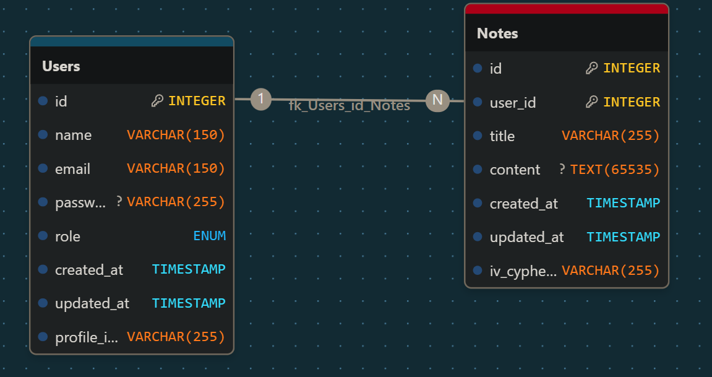
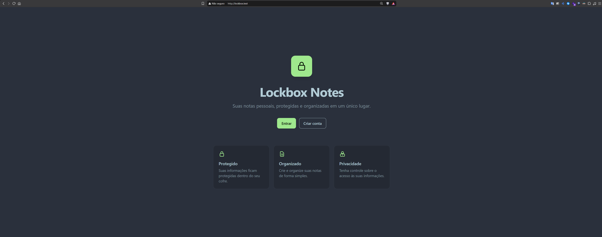
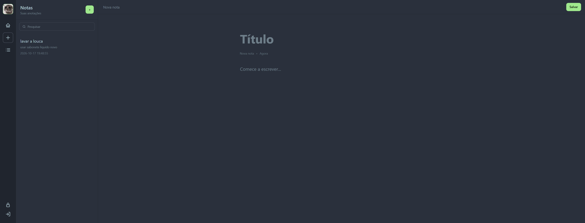
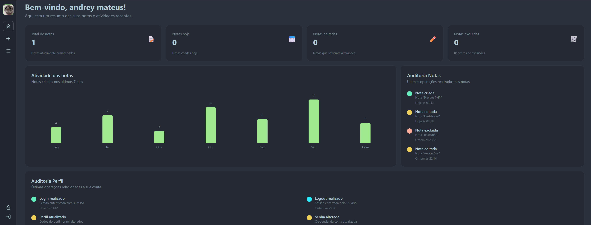
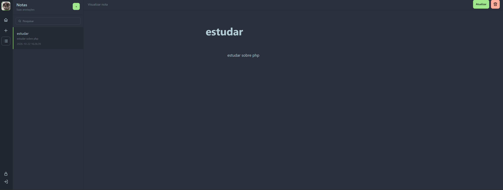
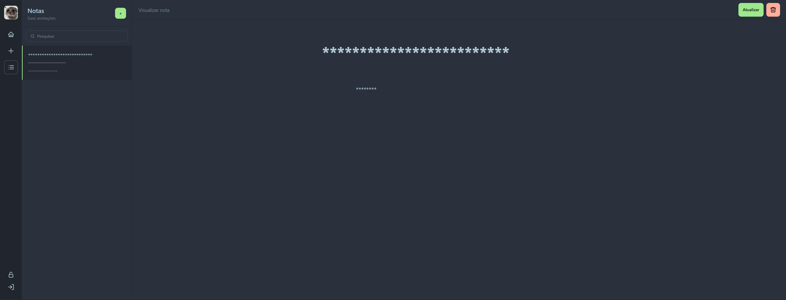

# Lockbox Notes

Sistema web de gerenciamento de anotações desenvolvido em PHP puro com foco em segurança e criptografia, com autenticação de usuários, organização de notas, controle de perfil e registro de auditoria.

**OBS:** Partes do sistema estão em manutenção/adição.

**VOCÊ PROVAVELMENTE VAI ENCONTRAR ALGUMAS "TODOS", estão sendo feitas em meu tempo livre.**

## Sumário do README.md

```
README
│
├── Sobre o projeto
├── Funcionalidades
├── Tecnologias
├── Como rodar
├── Modelagem do Banco
├── Arquitetura
│   ├── App/Core + MVC
│   ├── Controllers
│   ├── Models
│   └── Views
├── Logs e Auditoria
├── Segurança
|── Conceitos aplicados
|── Decisões de arquitetura
└── Melhorias futuras
```

## Funcionalidades

* Cadastro e autenticação de usuários
* Login e logout
* Gerenciamento de perfil
* Upload de foto de perfil
* Alteração de senha
* Criação de notas
* Edição de notas
* Exclusão de notas
* Visualização de notas
* Pesquisa e filtragem
<!-- * Paginação -->
* Registro de ações através de logs e auditoria (Em manutenção)
* Dashboard com informações da aplicação
* Interface responsiva
* Tema escuro

## Tecnologias

* PHP
* MySQL
* SQL
* HTML5
* CSS3
* Tailwind CSS
* DaisyUI
* JavaScript
* Git
* MVC

## Como rodar

### Requisitos

* PHP 8.5+
* MySQL
* Apache ou outro servidor web compatível

### Instalação

Clone o repositório: ``git clone https://github.com/AndreyMateus/lockbox``

### Opção 1 - Executar localmente (recomendado para estudos)

Para rodar o projeto localmente, você precisa de um ambiente que execute PHP.

Você pode usar qualquer uma das opções abaixo:

* **XAMPP**
* **Laravel Herd**
* **Laragon**
* **WAMP**
* Ou qualquer stack PHP similar

#### Passos (XAMPP)

1. Instale um dos ambientes citados acima
2. Coloque o projeto dentro da pasta de servidor  
   * Exemplo no XAMPP:  

     ```
     C:\xampp\htdocs\lockbox
     ```

3. Inicie o servidor (Apache)
4. Abra o navegador e acesse o seu localhost ou endereço definido pelo AMBIENTE (software que simula o servidor, Ex: xampp, Laravel herd, etc...)

Configure as credenciais do banco de dados no arquivo de configuração da aplicação em `Core/Config/config.php`.

Crie o banco de dados e execute o script SQL disponível no projeto para criar as tabelas necessárias em `App/Database/database.sql`.

Configure o servidor web para utilizar a pasta `Public/` como diretório público da aplicação. **(OPCIONAL)**

Após a configuração, acesse o projeto através do servidor local.

## Modelagem do Banco

A aplicação utiliza um banco de dados relacional para armazenar usuários, notas e informações relacionadas à auditoria.

Principais entidades:

A tabela `users` armazena os dados dos usuários.

A tabela `notes` armazena as anotações associadas aos usuários.

(Em implementação)
As tabelas de auditoria registra eventos relevantes realizados na aplicação, permitindo rastrear determinadas operações, sendo um dos pilares da segurança da informação, conhecido como: **NÃO REPUDIO**.

### Relacionamentos



## Arquitetura

O projeto utiliza uma arquitetura baseada em MVC, combinada com a separação entre `App` e `Core`.

A ideia é separar as responsabilidades da aplicação, evitando concentrar regras de negócio, acesso ao banco de dados, roteamento e apresentação em um único local.

### App/Core + MVC

Uma representação simplificada da estrutura:

```text
Notes/
│
├── App/
│   ├── Controllers/
│   │       ├── Notes/
│   ├── Database/
│   ├── logs/
│   ├── Middlewares/
│   ├── Models/
│   ├── Views/
│   │       ├── notes/
│   │       ├── partials/
│   │       ├── template/
│
├── Core/
│   ├── Config/
│   ├── Helpers/
│   ├── Route/
│   ├── Utils/
│   
├── Public/
│   ├── assets/
│   ├── uploads/
│   │     ├── profile_images/
│   └── index.php
│
├── .gitignore
├── .env
└── README.md
```

**Padrão MVC**

### Controllers

Os controllers recebem e processam as requisições da aplicação.

Eles são responsáveis por coordenar o fluxo da requisição, utilizando as demais camadas necessárias e encaminhando os dados para as views.

A intenção é evitar que o controller concentre diretamente regras de negócio ou consultas ao banco.

**OBS:** alguns controllers com bastante verbosidade de código estão utilizando o padrão de projeto **SINGLE ACTION CONTROLLER**

### Models

Os models representam as entidades e os dados utilizados pela aplicação.

Eles são utilizados em conjunto com as demais camadas para trabalhar com informações como usuários e notas.

### Views

As views são responsáveis pela apresentação dos dados ao usuário.

A camada de apresentação é mantida separada da lógica responsável pelo processamento das requisições e pelas regras da aplicação.

## Logs e Auditoria (Em implementação)

O sistema possui mecanismos de registro para acompanhar determinadas ações realizadas na aplicação.

Entre os eventos registrados estão operações relacionadas às notas e alterações relevantes realizadas pelo usuário.

A auditoria tem como objetivo fornecer rastreabilidade das operações realizadas no sistema.

Isso permite consultar posteriormente informações relacionadas a eventos ocorridos durante a utilização da aplicação.

## Segurança

O projeto utiliza algumas práticas para reduzir riscos comuns em aplicações web, incluindo:

* Prepared Statements através do PDO
* Validação dos dados recebidos
* Validação do MIMETYPE dos arquivos recebidos (Validação de uploads)
* Sanitização da saída utilizando `htmlspecialchars()`
* Controle de sessão
* Controle de acesso às áreas autenticadas
* Proteção de informações sensíveis
* Separação entre arquivos públicos e código interno
* Senhas armazenadas utilizando hashing

Informações sensíveis de configuração não devem ser versionadas no Git.

## Conceitos aplicados

Durante o desenvolvimento foram aplicados conceitos como:

* MVC
* Front Controller
* Roteamento
* Namespaces
* Autoload
* PDO
* Prepared Statements
* Sessões
* Hash de senhas
* Criptografia com chave simétrica - (AES-256-CBC)
* Validação de dados
* Sanitização de saída
* Separação de responsabilidades
* Auditoria
* Controle de acesso
* log do server

## Decisões de arquitetura

A divisão entre `App` e `Core` foi utilizada para separar os componentes específicos da aplicação dos recursos fundamentais utilizados pelo sistema.

Dessa forma, uma requisição pode seguir um fluxo semelhante a:

```text
Request
   ↓
Router
   ↓
Controller
   ↓
 Model
   ↓
Database
```

E, após o processamento:

```text
Database
   ↓
 Model
   ↓
Controller
   ↓
 View
   ↓
Response
```

Essa organização facilita a manutenção e permite alterar uma parte da aplicação sem concentrar todas as alterações em um único arquivo.

## Melhorias futuras

Algumas funcionalidades consideradas para atualizações futuras:

* Recuperação de senha por e-mail
* Após desbloquear o cadeado, ser redirecionado para a página onde o cadeado foi acionado
* Anexos nas notas (files)
* Melhoria na UI Mobile
* Melhorias de acessibilidade - front-end mobile
* Refatoração do código
* Adição de Camadas como Services e Repositories
* Sistema de Role/Cargo, onde o ADMIN terá acesso a todas as notas de todos os usuários
* cada usuário terá sua própria chave simétrica individual salva com seu perfil no banco.
* Maior cobertura de validações
* Melhorias no sistema de auditoria (Em Manutenção)
* Adição de uma LLM via API para gerar resumos e INSIGHTS
* Regenerate ID para SESSION a cada vez que fizer login
* validação para senha do cadeado ser obrigatoriamente diferente da senha de lohin

## Telas

### Index



### Login


### Register


### Profile


### Create Note



### Alter Note
<!--  -->

### Dashboard



### List Notes



### List Notes LOCKED



### Padlock


